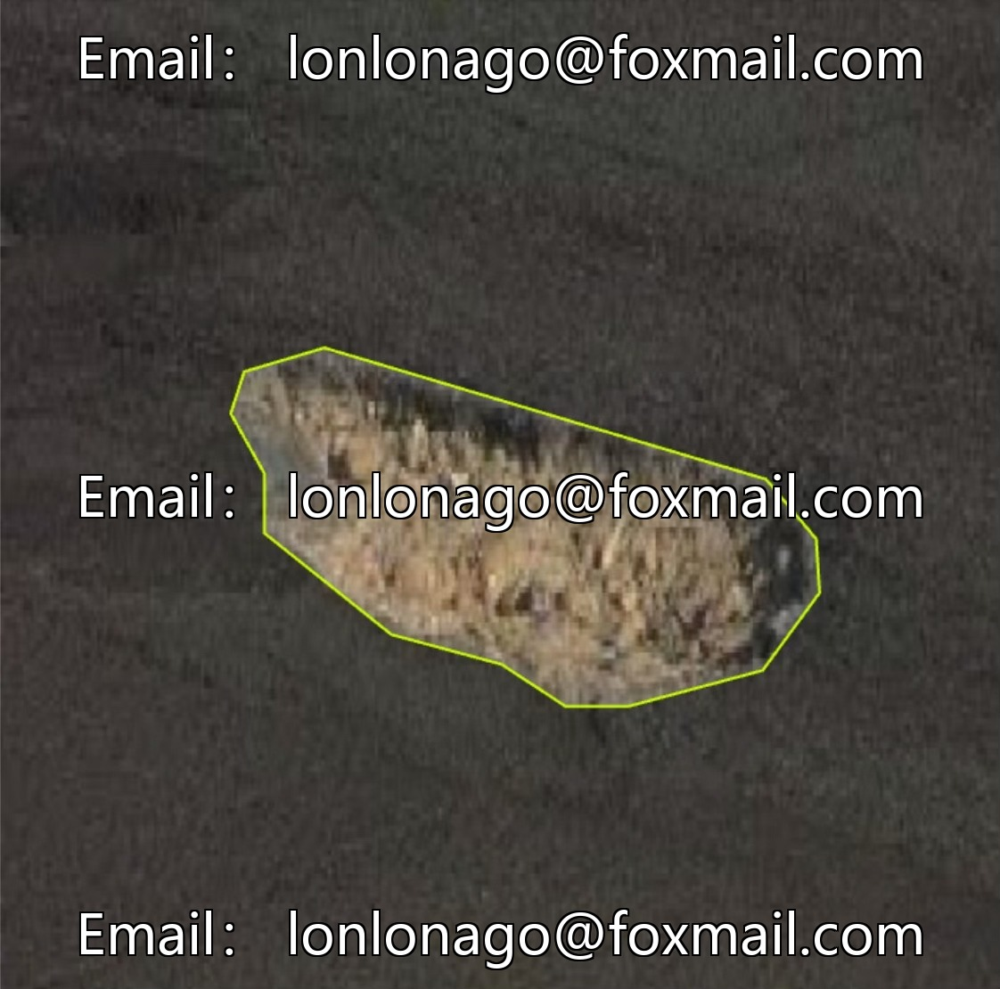
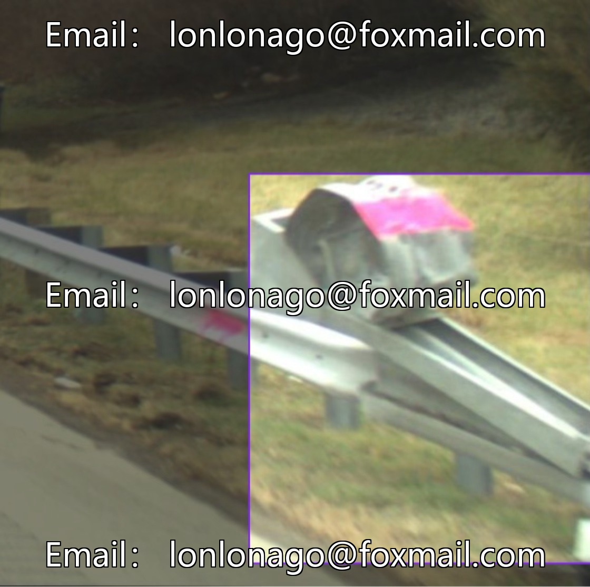

# High-speed barrier maintenance YOLO dataset

## Body

High-speed barrier maintenance YOLO dataset for high-speed barrier maintenance image dataset, including two scenarios: road pits and barriers, with 2200 images in YOLO annotation format, suitable for intelligent traffic monitoring, road safety hazard detection, decision support for barrier maintenance, etc.

The dataset covers different weather, lighting and road types, with clear annotations. The model training is effective, supporting deep learning and object detection.

Virtual materials, once sold, are non-refundable.
Interested friends, click "I want" to proceed.

## Images

## Payment

Here is a pay link on Stripe ( https://buy.stripe.com/3cs8yP7sY87d0vu9AB ). Please contact me lonlonago@foxmail.com after funding $89, and I will send you a complete data files , thank you!

